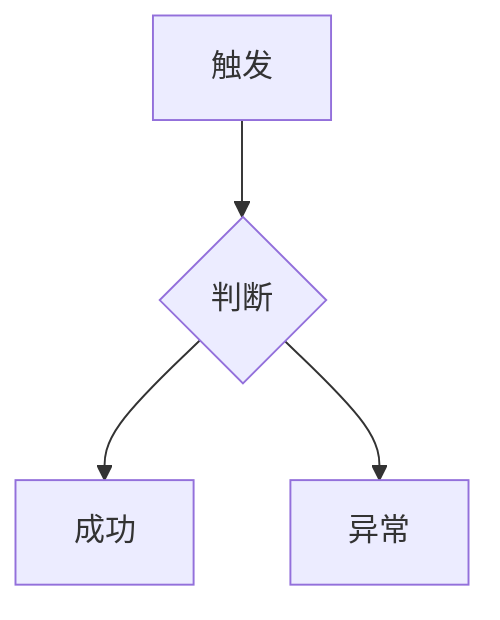
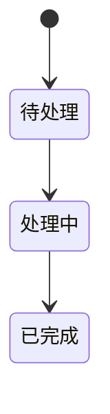

# Requirement Specification Template

Use this structure for `requirement-spec.md`. Remove sections that genuinely do not apply and state why.

```markdown
# <需求标题> 需求规格说明书

## 1. 文档信息

| 项目 | 内容 |
|---|---|
| 需求编号 | REQ-... |
| 迭代 | ... |
| 产品经理 | ... |
| 文档状态 | DRAFT / PENDING_CONFIRMATION / READY_FOR_REVIEW / CONFIRMED |
| 版本 | v0.1 |
| 更新时间 | YYYY-MM-DD HH:mm |

## 2. 需求背景

## 3. 业务目标

## 4. 需求范围

## 5. 明确不在范围内

## 6. 角色与权限

| 角色 | 可查看 | 可创建 | 可修改 | 可删除 | 可审批 |
|---|---|---|---|---|---|

## 7. 术语定义

## 8. 现有业务与系统实现

- [FACT] ...
- [INFERENCE] ...
- [CONFLICT] ...

## 9. 业务流程



## 10. 功能需求

### FR-001 <名称>

- 业务目标
- 触发条件
- 前置条件
- 操作角色
- 输入
- 正常流程
- 异常流程
- 数据变化
- 状态变化
- 权限约束
- 验收标准

## 11. 详细业务规则

| 规则 ID | 规则 | 来源 / 决策 | 状态 |
|---|---|---|---|

## 12. 状态定义与转换



## 13. 输入、输出与数据规则

## 14. 正常流程

## 15. 异常流程

| 场景 | 系统行为 | 用户可见结果 |
|---|---|---|

## 16. 权限与数据范围

## 17. 并发、幂等与重复操作

## 18. 外部依赖与异步处理

## 19. 日志、审计与监控

## 20. 兼容性与迁移

## 21. 非功能需求

## 22. 验收标准

Use Given-When-Then:

- Given ...
  When ...
  Then ...

## 23. 需求依赖

## 24. 未决事项

| ID | 问题 | 负责人 | 影响 | 下一步 |
|---|---|---|---|---|

## 25. 风险与限制

## 26. 决策记录

| ID | 决策 | 决策人 | 来源 | 时间 | 状态 |
|---|---|---|---|---|---|

## 27. 证据来源

| ID | 结论 | 类型 | 来源 |
|---|---|---|---|
```
